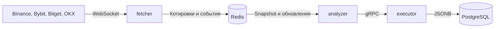

# Crypto Monitor

Микросервисное приложение для отслеживания потенциальных арбитражных возможностей между спотовыми рынками **Binance, Bybit, Bitget и OKX** для торговых пар с **USDT**. Сервис сравнивает котировки с учетом комиссий и доступного объема, а найденные сигналы сохраняет в PostgreSQL

## Общая схема связи

## Процесс обработки данных

- `fetcher` подключается к Binance, Bybit, Bitget и OKX через WebSocket и получает лучшие bid/ask с доступными объемами. Для каждой пары монета/биржа буфер сохраняет последнее обновление, промежуточные обновления вытесняются. Запись в Redis выполняется отдельно от чтения WebSocket

- Каждая котировка получает абсолютный срок истечения - время источника + `price_ttl`. Доставка и ожидание в буфере не продлевают оставшийся срок жизни. Истекшие котировки пропускаются. После записи публикуется событие обновления, инвалидация при пустом стакане удаляет котировку и публикует событие инвалидации

- `analyzer` подписывается на события, загружает снимок текущих котировок для настроенных монет и бирж. Дальнейшие обновления поддерживают его локальное состояние. Проверяются цены, объемы, абсолютный срок истечения и возраст от времени получения через `max_quote_age`. Само истечение Redis TTL не публикует событие в канал котировок, свежесть проверяется при обработке обновлений

- Для одной монеты сравниваются покупка по ask на одной бирже и продажа по bid на другой. Количество ограничивается возможным обьемом. С учетом комиссии каждой биржи, выбирается пара с максимальной положительной прибылью в USDT

- Для каждой монеты запоминается отпечаток последнего сигнала, поставленного в очередь. Повторение того же отпечатка игнорируется, изменение времени или истечение котировок его не сбрасывает (т.к. биржа может не меняться произвольное время). Сигналы поступают в очередь, при переполнении вытесняется старейший сигнал. Отправка по gRPC выполняется последовательно, с таймаутом 3 секунды. После ошибки сигнал повторно в очередь не ставится

- `executor` проверяет поля сигнала и согласованность сумм, затем сохраняет его в `profit_deals` как JSONB

- Проверка WebSocket независима от обновлений
цен. heartbeat отправляется после запроса подписки и каждые 20 секунд, ответ ожидается 5 секунд. После последовательных сбоев применяются
паузы, 5-ый сбой отключает биржу до перезапуска
`fetcher`. Успешный heartbeat сбрасывает счетчик. Молчание цен само по себе не считается сбоем соединения

## Запуск и команды

**Требования:**

- Go 1.25+
- cgo (для тестов)
- protoc (для генерации кода)

| Команда | Действие |
| --- | --- |
| `make build` | Собрать три бинарника в `BIN_DIR` |
| `make clean` | Удалить три собранных бинарника сервисов из `BIN_DIR` |
| `make format` | Выполнить `gofmt` для исходников и тестов, согласовать `go.mod` и `go.sum` |
| `make check` | Запустить проверку `go vet ./...` |
| `make test` | Запустить все тесты без кеша результатов. Проверки внешних зависимостей могут быть пропущены |
| `make test-integration` | Поднять временные Redis и PostgreSQL, выполнить прогон всех тестов с `-race`, без кеша результатов, удалить окружение после завершения |
| `make tools` | Проверить наличие `protoc` и установить закрепленные версии Go плагинов protobuf |
| `make gen-proto` | Сгенерировать Go код protobuf и gRPC |
| `make up` | Собрать Docker образы и запустить приложение |
| `make reup` | Остановить приложение и пересобрать образы |
| `make down` | Остановить и удалить контейнеры и сеть приложения, сохранив volumes |
| `make logs` | Отображать логи сервисов |
| `make db-clean` | Удалить контейнеры, сеть и volumes |

## Тесты и покрытие

**Планируемое покрытие тестами:**

- [x] 1. Конфигурация и запуск сервисов
- [x] 2. Контракты данных и идентичность
- [x] 3. Подписки и разбор протоколов бирж
- [ ] 4. Нормализация стакана и времени источника
- [ ] 5. Здоровье WebSocket и heartbeat
- [ ] 6. Повторные подключения и отключение биржи
- [ ] 7. Состояние подписок и инструментов
- [ ] 8. Буфер последних котировок и Redis writer
- [ ] 9. Свежесть цены и запись в Redis
- [ ] 10. Подписка analyzer и начальный snapshot
- [ ] 11. Пригодность котировки в analyzer
- [ ] 12. Локальное состояние цен и порядок событий
- [ ] 13. Расчет и выбор арбитражной пары
- [ ] 14. Отпечаток последнего сигнала
- [ ] 15. Очередь и отправка сигналов
- [ ] 16. Передача через gRPC
- [ ] 17. Проверка наблюдения в executor
- [ ] 18. Сохранение в PostgreSQL
- [ ] 19. Сквозные свойства и восстановление
- [ ] 20. Конкурентность и завершение работы
- [ ] 21. Диагностика и наблюдаемость
- [ ] 22. Сборка, запуск и эксплуатационный контракт
- [ ] 23. Инструменты измерения задержек

## Настройки и подключения

Конфигурации: `fetcher/config.yaml`, `analyzer/config.yaml`, `executor/config.yaml`. Монеты задаются в `fetcher` и `analyzer`, биржи и комиссии - в `analyzer`

Переменные окружения имеют приоритет над YAML:

| Переменные | Назначение |
| --- | --- |
| `TRACKED_COINS` | Монеты через запятую |
| `REDIS_ADDR`, `DATABASE_URL` | Подключения к Redis и PostgreSQL |
| `EXECUTOR_GRPC_ADDR`, `EXECUTOR_GRPC_PORT` | Адрес и порт gRPC |
| `FETCHER_PRICE_TTL`, `ANALYZER_MAX_QUOTE_AGE` | Срок жизни и максимальный возраст цены |
| `BINANCE_WS_URL`, `BYBIT_WS_URL`, `BITGET_WS_URL`, `OKX_WS_URL` | WebSocket бирж |
| `LOG_LEVEL` | `DEBUG`, `INFO`, `WARN`, `ERROR` |

---
